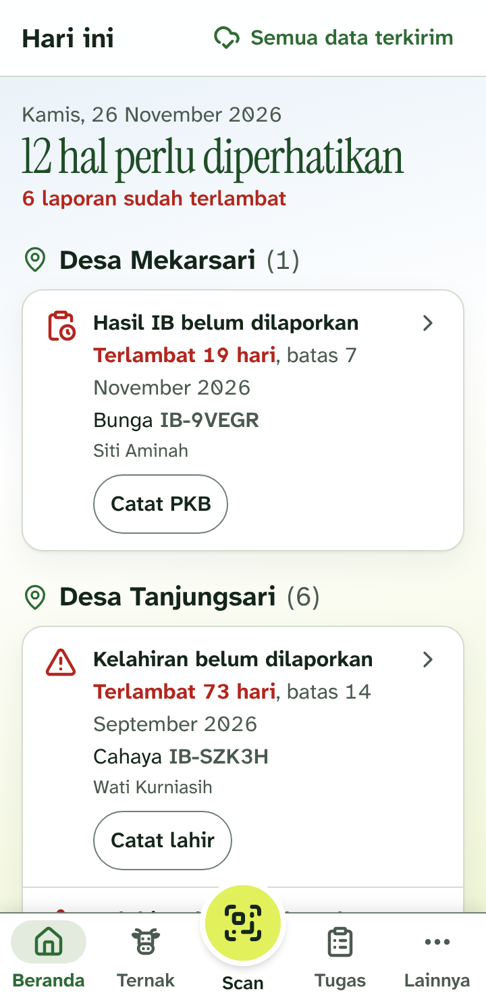
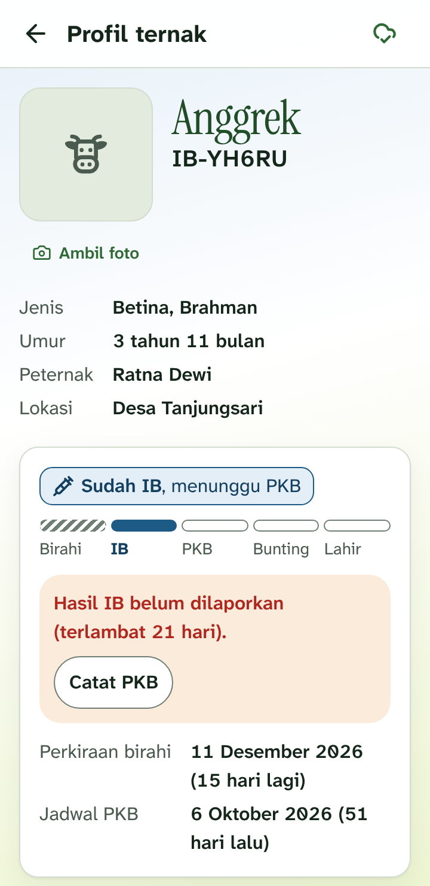
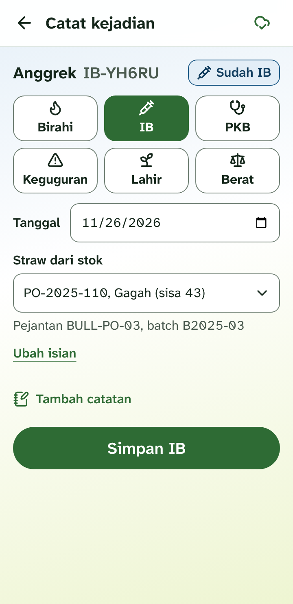
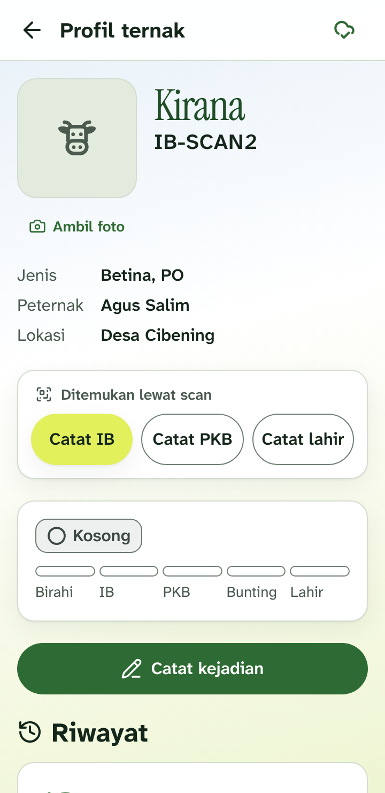
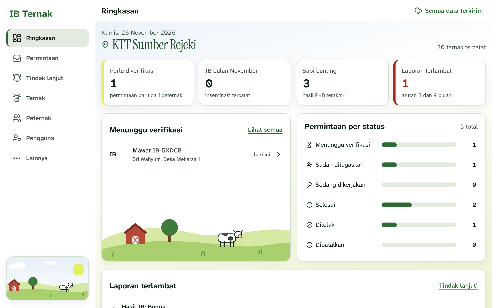

# IB Ternak

**Catatan reproduksi sapi yang tetap jalan tanpa sinyal.** Peternak, inseminator, dan admin
kelompok/dinas mencatat birahi, inseminasi buatan (IB), pemeriksaan kebuntingan (PKB), dan
kelahiran dari HP. Datanya tersimpan di HP dan terkirim sendiri ke server pos IB saat ada sinyal.

[](https://github.com/khaliladha11/ib-admin-system/actions/workflows/ci.yml)
[](LICENSE)

<table>
  <tr>
    <td></td>
    <td></td>
    <td></td>
    <td></td>
  </tr>
  <tr>
    <td align="center">Hari ini</td>
    <td align="center">Profil sapi</td>
    <td align="center">Catat IB</td>
    <td align="center">Scan label QR</td>
  </tr>
</table>



## Fitur

- **Offline dulu.** Semua pencatatan berjalan tanpa internet dan sinkron menyusul. Aplikasi bisa
  dipasang ke layar utama HP (PWA). Bila dua HP mengubah data yang sama, tidak ada data yang hilang
  diam-diam ([`docs/SYNC.md`](docs/SYNC.md)).
- **Sapi sebagai pusat data.** Status reproduksi (birahi, sudah IB, bunting, …) dihitung dari urutan
  kejadian, bukan diketik. Koreksi ditambahkan sebagai catatan baru tanpa menimpa yang lama.
  Catatan yang tidak masuk akal ditolak atau diberi peringatan.
- **Pengingat dari skripsi.** Hasil IB belum dilaporkan lebih dari 3 bulan, dan kelahiran belum
  dilaporkan setelah lewat perkiraan lahir. Keduanya dihitung dari tanggal kejadian sebenarnya,
  dengan tombol pengingat WhatsApp berisi pesan siap kirim.
- **Permintaan layanan.** Peternak minta IB/PKB, admin memverifikasi dan menugaskan atau mengganti
  petugas, petugas menerima dan mencatat hasilnya. Setiap langkah tercatat beserta pelakunya.
- **Label QR dan scan.** Cetak label A4 (24 atau 40 per lembar), scan dengan kamera HP (juga offline),
  daftarkan sapi baru dari label kosong, atau ketik nomor eartag.
- **Laporan.** S/C dan CR per petugas, desa, dan bulan, tren permintaan IB, dan waktu respons
  petugas. Bisa diunduh sebagai Excel atau dicetak/PDF; rumusnya ditampilkan di halaman.
- **Pos IB tanpa internet.** Satu komputer atau Raspberry Pi di pos menjadi server untuk HP di Wi-Fi
  yang sama, dengan HTTPS lokal, cadangan harian, serta ekspor/impor JSON dan CSV.
- **Mudah dipakai di lapangan.** Tombol besar (≥ 44px), kontras tinggi untuk terik matahari, huruf
  Atkinson Hyperlegible, Bahasa Indonesia sederhana.
- **Selaras iSIKHNAS.** Kode kejadian BH, IB, PKB, KGG, LH, BB.
- **Siap uji coba.** Mode latihan dengan data contoh yang bisa direset, form masukan, catatan
  pemakaian anonim yang hanya tersimpan di HP, dan panduan cetak satu halaman.

## Mencoba

### Di komputer sendiri (pengembang)

Prasyarat: Node.js 22 (`.nvmrc`) dan pnpm 10.

```bash
pnpm install
```

```bash
pnpm db:migrate && pnpm db:seed
```

```bash
pnpm dev
```

Buka `http://localhost:5173`. Semua akun contoh (fiktif) memakai password `contoh123`:

| Peran | Login |
| --- | --- |
| Admin dinas | `admin.dinas@contoh.test` |
| Admin kelompok | `admin.ktt01@contoh.test`, `admin.ktt02@contoh.test` |
| Inseminator | `081200000201`, `081200000202`, `081200000203` |
| Peternak | `081200000100`, `081200000103`, `081200000106` |

Dokumentasi API ada di `http://localhost:3000/api/docs`. Untuk mencoba kamera di HP lewat Wi-Fi,
lihat [`docs/UJI-HP.md`](docs/UJI-HP.md).

### Dengan Docker (server latihan berisi data contoh)

Butuh Docker dengan Compose v2. Perintah ini membangun aplikasi lalu menjalankannya di balik Caddy
(HTTPS lokal):

```bash
printf 'POS_HOST=localhost\nDEMO_MODE=1\n' > .env
```

```bash
docker compose up -d --build
```

Buka `https://localhost`. Peramban akan memperingatkan sertifikat lokal; lanjutkan saja.
Data contoh bisa dikembalikan dari halaman **Pos IB → Reset data demo** (admin dinas).

## Memasang di pos IB

Untuk komputer Linux atau Raspberry Pi di pos, satu baris:

```bash
curl -fsSL https://raw.githubusercontent.com/khaliladha11/ib-admin-system/main/scripts/install.sh | bash
```

Panduan lengkap untuk non-programmer ada di [`docs/INSTALL.md`](docs/INSTALL.md): Windows,
memasang sertifikat di HP Android, cadangan dan pemulihan, ekspor/impor, dan masalah umum.

## Asal-usul

Proyek ini berawal dari skripsi saya di Ilmu Komputer IPB (2025): *"Pengembangan Sistem Informasi
Permintaan Inseminasi Buatan (IB) Berbasis Web Guna Mendukung Koordinasi Stakeholder"*
(Muhammad Khalil Adha). Versi skripsi (Express + PostgreSQL + React) diarsipkan apa adanya di
[`legacy/`](legacy/README.md) dan tag git [`v3.1-legacy`](https://github.com/khaliladha11/ib-admin-system/tree/v3.1-legacy).
Abstraknya ada di [`docs/skripsi/README.md`](docs/skripsi/README.md).

IB Ternak adalah tulis ulang dari nol dengan tujuan yang lebih luas: dipakai langsung di kandang,
termasuk tanpa sinyal. Pelajaran dari versi skripsi (route tanpa otorisasi, laporan yang saling
menimpa, pengingat 9 bulan yang tidak pernah aktif, dan lainnya) dicatat di
[`docs/legacy/DOMAIN.md`](docs/legacy/DOMAIN.md) dan menjadi aturan di rebuild ini. Versi skripsi
masih bisa dijalankan dengan `cd legacy && docker compose up`.

## Untuk pengembang

| Perintah | Fungsi |
| --- | --- |
| `pnpm dev` | Web (5173) + server (3000) |
| `pnpm test` | Unit test (Vitest) di semua paket |
| `pnpm typecheck` / `pnpm lint` | TypeScript, ESLint, dan cek format Prettier |
| `pnpm e2e` | Playwright di layar HP 360×740 dan PC 1280×800, termasuk offline dan dua HP |
| `pnpm build` | Build produksi web (PWA) |
| `pnpm db:migrate` / `pnpm db:seed` | Database SQLite dan data contoh fiktif |

```
apps/web         Aplikasi web (React, Vite, TanStack Router, Tailwind, Dexie, PWA)
apps/server      API (Hono, Drizzle, SQLite)
packages/shared  Skema dan logika domain (mesin status, pengingat, sinkron) untuk web & server
legacy/          Arsip versi skripsi, hanya referensi
docs/            Rencana, desain, sinkron, instalasi, UAT, panduan cetak
```

Dokumen penting: [`docs/PLAN.md`](docs/PLAN.md) (roadmap dan model data),
[`docs/DESIGN.md`](docs/DESIGN.md), [`docs/SYNC.md`](docs/SYNC.md), [`docs/UAT.md`](docs/UAT.md),
[`CHANGELOG.md`](CHANGELOG.md).

Ingin membantu? Baca [`CONTRIBUTING.md`](CONTRIBUTING.md) dan cari issue berlabel
[`good first issue`](https://github.com/khaliladha11/ib-admin-system/labels/good%20first%20issue).
Laporan celah keamanan: [`SECURITY.md`](SECURITY.md).

## Lisensi

[GNU Affero General Public License v3.0](LICENSE) © 2025–2026 Muhammad Khalil Adha.

Boleh dipakai, dipelajari, diubah, dan dibagikan. Bila Anda menjalankan versi yang **diubah**
untuk orang lain (misalnya server dinas), kode sumber perubahan itu wajib dibagikan juga kepada
penggunanya. Aplikasi menampilkan tautan kode sumber di **Lainnya → Tentang aplikasi**; isi
`VITE_SOURCE_URL` dengan alamat kode Anda sendiri.

Sebelum v1.0.0, README repo ini menyebut lisensi MIT. Mulai v1.0.0 seluruh repo, termasuk
`legacy/`, memakai AGPL-3.0. Salinan yang sudah diambil di bawah MIT sebelumnya tetap berlaku.
