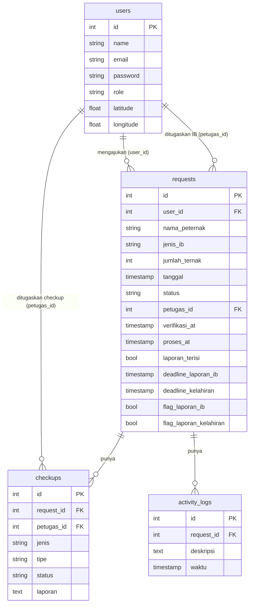
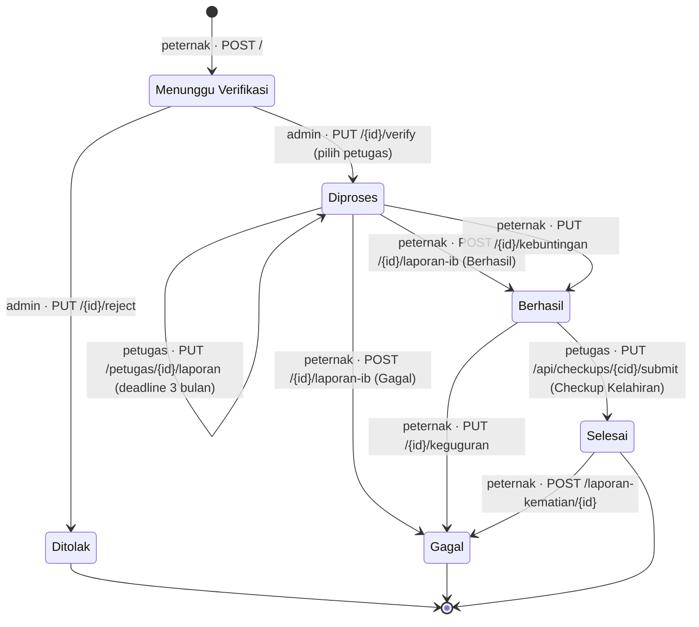
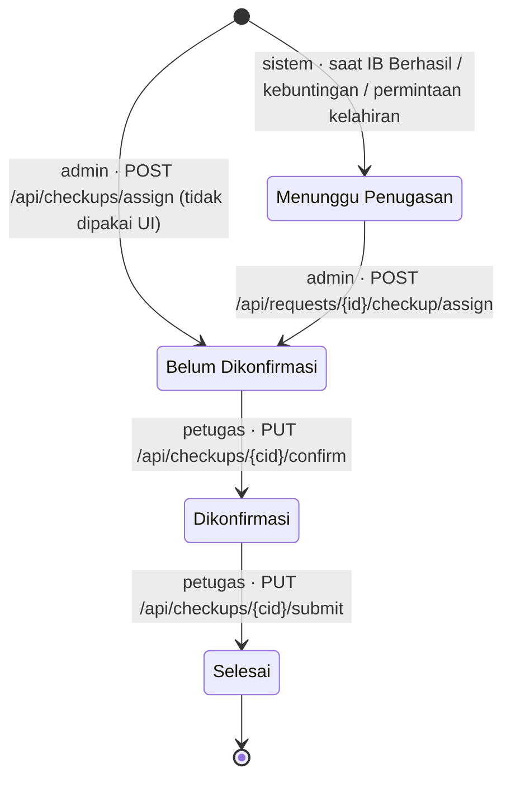
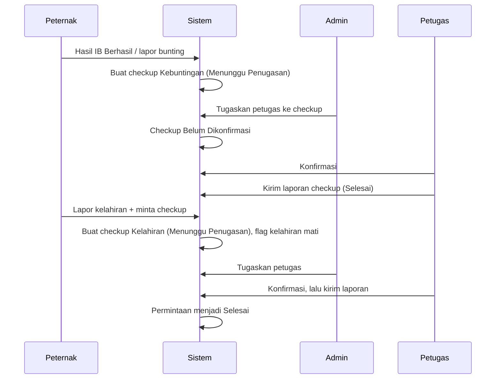

# Referensi Domain Versi Skripsi (Legacy)

Dokumen referensi untuk rebuild. Isinya direkonstruksi dengan membaca seluruh
kode di [`legacy/`](../../legacy/README.md) (tag git `v3.1-skripsi`). Kode legacy
**tidak diubah**; masalah di §5 hanya catatan untuk dipelajari, bukan diperbaiki
di sana.

- Skema database hasil rekonstruksi: [`schema.sql`](schema.sql)
- Rencana rebuild: [`docs/PLAN.md`](../PLAN.md)

**Legenda keyakinan**
- **[pasti]**: terlihat langsung di kode (query SQL, route, kondisi UI).
- **[dugaan]**: disimpulkan dari pemakaian (tipe kolom, default, FK, peran).
- **[frontend]**: hanya dirujuk di frontend, tidak pernah ditulis backend.

Rujukan lokasi ditulis `file:baris` relatif terhadap `legacy/`.

---

## 1. Skema database

Repo tidak menyertakan skema atau migrasi. Ada **4 tabel** yang dipakai di query;
tidak ditemukan tabel lain. Versi lengkap dengan tipe ada di
[`schema.sql`](schema.sql). File itu sudah diuji bisa dimuat di PostgreSQL 16,
dan setiap kolom yang muncul di query backend tercantum di sana.

### 1.1 `users`

| Kolom | Tipe [dugaan] | Keterangan |
| --- | --- | --- |
| `id` | serial PK | Disimpan frontend di `sessionStorage.userId` |
| `name` | varchar | Ditampilkan di navbar; dipakai sebagai `nama_petugas` lewat JOIN |
| `email` | varchar | Keunikan dicek manual di `register` (`backend/controllers/authController.js:37-40`) |
| `password` | varchar | Hash bcryptjs, cost 10 |
| `role` | varchar | `'admin'`, `'petugas'` [pasti]; peternak [dugaan], tidak ada UI-nya di repo |
| `latitude`, `longitude` | double | Diisi saat register, tidak dipakai di tempat lain |

### 1.2 `requests`

Satu baris = satu permintaan IB **beserta seluruh hasil lanjutannya** (laporan IB,
kebuntingan, keguguran, kelahiran, kematian anak).

| Kelompok | Kolom | Keterangan |
| --- | --- | --- |
| Identitas | `id`, `user_id`, `nama_peternak` | `nama_peternak` disalin sebagai teks, bukan relasi |
| Permintaan | `jenis_ib`, `jumlah_ternak`, `latitude`, `longitude`, `tanggal` | `tanggal` = `NOW()` saat dibuat |
| Status | `status` | Lihat §2.1 |
| Penugasan | `petugas_id`, `verifikasi_at` | Diisi saat verifikasi; `verifikasi_at` di-reset saat ganti petugas |
| Proses IB | `proses_at`, `laporan_terisi`, `laporan_ib_text`, `deadline_laporan_ib` | `deadline_laporan_ib` = waktu laporan petugas + 3 bulan |
| Hasil IB (peternak) | `laporan_ib_status` | `'Berhasil'` atau `'Gagal'` |
| Laporan peternak | `laporan_peternak_text`, `laporan_peternak_keguguran`, `laporan_peternak_kelahiran`, `laporan_peternak_kematian`, `laporan_kematian_at` | Teks bebas |
| Pengingat | `flag_laporan_ib`, `flag_laporan_kelahiran`, `deadline_kelahiran` | Lihat §4 |
| [frontend] | `flag_laporan_kebuntingan`, `checkup_status` | Dibaca di `frontend/src/pages/dashboardAdmin.jsx:32,102`, tidak pernah ditulis backend |

### 1.3 `checkups`

| Kolom | Keterangan |
| --- | --- |
| `id`, `request_id`, `petugas_id` | `petugas_id` NULL selama `Menunggu Penugasan` |
| `jenis` | Hanya ditulis oleh `POST /api/checkups/assign` (`backend/controllers/checkupController.js:9`) |
| `tipe` | `'Checkup Kebuntingan'` atau `'Checkup Kelahiran'`; dipakai semua kode lain |
| `status` | Lihat §2.1 |
| `laporan` | Awalnya diisi catatan peternak (checkup kelahiran), lalu ditimpa laporan petugas |
| `tanggal`, `created_at`, `konfirmasi_at`, `laporan_at` | Cap waktu tiap tahap; `created_at` tidak diisi oleh sebagian INSERT |

### 1.4 `activity_logs`

`id`, `request_id`, `deskripsi` (teks bebas berbahasa Indonesia), `waktu` (`NOW()`).
Hanya bisa ditambah, tidak pernah diubah atau dihapus oleh kode.

---

## 2. Status & transisi

### 2.1 Semua nilai status di kode

| Kolom | Nilai | Arti |
| --- | --- | --- |
| `requests.status` | `Menunggu Verifikasi` | Baru diajukan peternak |
| | `Diproses` | Sudah diverifikasi & ditugaskan; tetap `Diproses` selama proses dan setelah laporan IB petugas |
| | `Ditolak` | Ditolak admin |
| | `Berhasil` | Peternak melapor IB berhasil / sapi bunting |
| | `Gagal` | IB gagal, keguguran, atau anak sapi mati |
| | `Selesai` | Laporan checkup kelahiran petugas sudah masuk |
| `requests.laporan_ib_status` | `Berhasil`, `Gagal` | Hasil IB menurut peternak |
| `checkups.status` | `Menunggu Penugasan` | Dibuat sistem, belum ada petugas |
| | `Belum Dikonfirmasi` | Sudah ditugaskan admin |
| | `Dikonfirmasi` | Petugas menerima tugas |
| | `Selesai` | Petugas mengirim laporan |
| `checkups.tipe` | `Checkup Kebuntingan`, `Checkup Kelahiran` | Jenis pemeriksaan |
| `users.role` | `admin`, `petugas` | Peran login di frontend |

### 2.2 State machine permintaan (`requests.status`)

Label panah: *peran · endpoint*. Semua path di bawah `/api/requests` kecuali
disebut lain; `{id}` = ID permintaan.

Catatan:
- Panah di atas adalah alur yang **dimaksud** (diturunkan dari kondisi tombol di
  UI dan komentar kode). Backend **tidak menjaga** transisi: hanya
  `POST /laporan-kematian/{id}` yang memeriksa status awal
  (`backend/routes/requestRoutes.js:101`). Endpoint lain bisa dipanggil dari
  status apa pun, misalnya `reject` setelah `Berhasil`.
- `kirimLaporanIB` dan `kirimKebuntingan` sama-sama menghasilkan `Berhasil` dan
  sama-sama membuat checkup kebuntingan (lihat §5, B5).

### 2.3 Sub-tahap tersirat di status `Diproses`

Status `Diproses` mencakup tiga tahap yang dibedakan lewat kolom lain:

| Tahap | Kondisi | Tampil di |
| --- | --- | --- |
| Menunggu petugas mulai | `verifikasi_at` terisi, `proses_at` NULL | Tombol "Mulai Proses IB" (`frontend/src/pages/detailRequestPetugas.jsx:124`) |
| Proses berjalan | `proses_at` terisi, `laporan_terisi = false` | Form laporan IB petugas |
| Menunggu hasil dari peternak | `laporan_terisi = true`, `laporan_ib_status` kosong | Kandidat flag pengingat 3 bulan |

### 2.4 State machine checkup (`checkups.status`)

Seperti di permintaan, `confirm` dan `submit` tidak memeriksa status sebelumnya.

---

## 3. Endpoint API

Base URL `http://localhost:5000/api`. **Tidak ada endpoint yang memerlukan login**
(lihat §5, S1). Kolom *Peran* menunjukkan siapa yang dimaksud memakai endpoint itu:
dari halaman frontend pemanggilnya, atau dari komentar kode untuk peternak.
Aplikasi peternak **tidak ada di repo ini**.

Singkatan file: `RC` = `backend/controllers/requestController.js`,
`CC` = `backend/controllers/checkupController.js`,
`AC` = `backend/controllers/authController.js`,
`RR` = `backend/routes/requestRoutes.js`.

### 3.1 Autentikasi (`/api`)

| Method | Path | Peran | Fungsi | Dipakai UI |
| --- | --- | --- | --- | --- |
| POST | `/register` | publik | Buat user (role bebas dipilih) `AC:33` | tidak |
| POST | `/login` | publik | Cek bcrypt, kembalikan JWT 1 hari + `role`, `name`, `id` `AC:5` | ya |

### 3.2 Permintaan (`/api/requests`)

| Method | Path | Peran | Fungsi | Efek DB | Dipakai UI |
| --- | --- | --- | --- | --- | --- |
| POST | `/` | peternak | Buat permintaan `RR:59` | INSERT, status `Menunggu Verifikasi` | tidak |
| GET | `/` dan `/requests` | admin | Semua permintaan, yang ber-flag di atas `RC:3` | – | ya |
| GET | `/{id}` | admin, petugas | Detail + `nama_petugas` `RR:133` | – | ya |
| GET | `/{id}/logs` | admin, petugas | Log aktivitas urut waktu `RC:94` | – | ya |
| GET | `/{id}/checkups` | admin, petugas | Checkup permintaan + nama petugas `RC:317` | – | ya |
| GET | `/petugas/list` | admin | Daftar user ber-role `petugas` `RC:38` | – | ya |
| PUT | `/{id}/verify` | admin | Verifikasi & tugaskan `RC:129` | `Diproses`, `petugas_id`, `verifikasi_at` + log | ya |
| PUT | `/{id}/reject` | admin | Tolak dengan catatan `RC:71` | `Ditolak` + log | ya |
| PUT | `/{id}/ganti-petugas` | admin | Ganti petugas yang belum merespons `RC:276` | `petugas_id`, `verifikasi_at` + log | ya |
| POST | `/{id}/checkup/assign` | admin | Tugaskan checkup `Menunggu Penugasan` `RC:453` | checkup `Belum Dikonfirmasi` + log | ya |
| GET | `/checkups/menunggu` | admin | Checkup yang belum ditugaskan `RC:436` | – | ya |
| POST | `/{id}/reminder` | admin | "Kirim" pengingat (hanya menulis log) `RC:542` | log | ya |
| POST | `/update-flags` | admin (otomatis) | Hitung ulang flag pengingat `RC:483` | `flag_*` | ya, saat dasbor admin dibuka |
| GET | `/pending/timeout` | admin, petugas | Diverifikasi > 30 menit tapi belum diproses, semua petugas `RC:235` | – | ya |
| GET | `/petugas/{pid}/requests` | petugas | Permintaan milik petugas `RC:111` | – | tidak |
| GET | `/petugas/{pid}/all-requests` | petugas | Permintaan IB + checkup milik petugas `RC:49` | – | ya, polling 10 detik |
| GET | `/petugas/{pid}/tugas-belum-diproses` | petugas | Tugas IB yang belum dimulai `RC:255` | – | ya |
| GET | `/petugas/{pid}/laporan/lewat` | petugas | Proses > 24 jam tanpa laporan (`{pid}` diabaikan) `RC:300` | – | ya |
| PUT | `/petugas/{id}/proses` | petugas | Mulai proses IB (`{id}` = ID permintaan) `RC:153` | `proses_at` + log | ya |
| PUT | `/petugas/{id}/laporan` | petugas | Kirim laporan IB `RC:196` | `laporan_terisi`, `laporan_ib_text`, `proses_at`, `deadline_laporan_ib` + log | ya |
| POST | `/{id}/laporan-ib` | peternak | Hasil IB `Berhasil`/`Gagal` (transaksi) `RC:561` | status, `laporan_ib_*`; bila berhasil buat checkup kebuntingan | tidak |
| PUT | `/{id}/kebuntingan` | peternak | Lapor sapi bunting `RC:361` | `Berhasil`, `laporan_peternak_text`, checkup kebuntingan | tidak |
| PUT | `/{id}/keguguran` | peternak | Lapor keguguran `RC:334` | `Gagal`, `laporan_peternak_keguguran` | tidak |
| POST | `/{id}/checkup/kelahiran` | peternak | Lapor kelahiran & minta checkup `RC:393` | checkup kelahiran, `laporan_peternak_kelahiran`, flag kelahiran mati | tidak |
| POST | `/laporan-kematian/{id}` | peternak | Lapor anak sapi mati (wajib status `Selesai`) `RR:85` | `Gagal`, `laporan_peternak_kematian` | tidak |

### 3.3 Checkup (`/api/checkups`)

| Method | Path | Peran | Fungsi | Dipakai UI |
| --- | --- | --- | --- | --- |
| POST | `/assign` | admin | Buat checkup langsung `Belum Dikonfirmasi` (menulis `jenis`) `CC:5` | tidak |
| PUT | `/{cid}/confirm` | petugas | Konfirmasi tugas checkup `CC:27` | ya |
| PUT | `/{cid}/submit` | petugas | Kirim laporan; bila `Checkup Kelahiran` → permintaan `Selesai` `CC:56` | ya |
| GET | `/petugas/{pid}/pending` | petugas | Checkup `Belum Dikonfirmasi` milik petugas `CC:92` | ya |

### 3.4 Kode mati

Fungsi yang diekspor tetapi tidak dipasang di route: `getRequestById` (`RC:18`),
`petugasProsesIB` (`RC:175`), `petugasIsiLaporan` (`RC:229`, dummy).
`backend/index.js` adalah server kedua yang tidak memasang route apa pun.

---

## 4. Aturan bisnis

### 4.1 Pengingat hasil IB (3 bulan)

1. Petugas mengirim laporan IB → `deadline_laporan_ib = NOW() + 3 bulan` (`RC:208`).
2. Saat `update-flags` berjalan, `flag_laporan_ib` **menyala** bila
   `laporan_terisi = true`, tenggat sudah lewat, dan `laporan_ib_status` kosong (`RC:489`).
3. Flag **mati** bila `laporan_ib_status` sudah terisi (`RC:501`).
4. Admin melihat peringatan "Peternak belum mengirimkan laporan hasil IB awal" dan
   tombol *Ingatkan Peternak* (`frontend/src/pages/detailRequestAdmin.jsx:268`).

Patokan waktunya adalah **saat laporan dikirim**, bukan tanggal inseminasi yang sebenarnya.

### 4.2 Pengingat kelahiran (9 bulan)

Aturan skripsi: kelahiran/keguguran belum dilaporkan > 9 bulan setelah dinyatakan bunting.

- `update-flags` menyalakan `flag_laporan_kelahiran` bila status `Berhasil`,
  `deadline_kelahiran` lewat, dan belum ada laporan kelahiran/keguguran (`RC:514`).
- Flag dimatikan bila ada laporan kelahiran atau keguguran (`RC:525`), dan juga
  langsung saat peternak mengirim permintaan checkup kelahiran (`RC:417`).
- **Namun `deadline_kelahiran` tidak pernah diisi di kode mana pun**, sehingga
  flag ini tidak akan pernah menyala lewat kode (§5, B1). Angka "9 bulan" tidak
  muncul di kode sama sekali.

### 4.3 Flag otomatis

- Flag disimpan di kolom, bukan dihitung saat dibaca.
- Satu-satunya pemicu: dasbor admin memanggil `POST /update-flags` setiap kali
  halaman dibuka (`frontend/src/pages/dashboardAdmin.jsx:57`). Tanpa admin yang
  membuka dasbor, flag tidak berubah. Tidak ada cron.
- `GET /` mengurutkan baris ber-flag di atas (`RC:8`). Dasbor admin juga punya
  bagian "Prioritas" untuk permintaan ber-flag.
- *Ingatkan Peternak* hanya menulis baris log
  "Admin mengingatkan peternak untuk mengirim laporan …" (`RC:548`). Tidak ada
  notifikasi sungguhan ke peternak.

### 4.4 Tenggat operasional petugas

| Aturan | Ambang | Lokasi | Akibat |
| --- | --- | --- | --- |
| Petugas belum memulai proses setelah diverifikasi | > 30 menit | `RC:244`, `frontend/src/pages/detailRequestAdmin.jsx:34` | Admin melihat tombol *Ganti Petugas*; petugas melihat notifikasi keterlambatan |
| Petugas belum mengirim laporan setelah memulai proses | > 24 jam | `RC:307` | Daftar "laporan terlambat" di dasbor petugas |

Ambang ditulis langsung di SQL dan JSX, tidak ada konstanta bersama.

### 4.5 Penugasan checkup

- Checkup kebuntingan dibuat otomatis oleh sistem; checkup kelahiran atas permintaan peternak.
- Admin memilih petugas mana saja; tidak harus petugas IB awal.
- Petugas melihat checkup miliknya lewat `GET /api/checkups/petugas/{pid}/pending`
  dan tombol di detail permintaan.
- Laporan checkup kebuntingan tidak mengubah status permintaan; hanya checkup
  kelahiran yang menutup permintaan menjadi `Selesai`.

### 4.6 Log aktivitas

Ditulis oleh hampir setiap aksi yang mengubah data. Isinya kalimat bebas
(mis. "Permintaan diverifikasi dan ditugaskan ke petugas ID 3"), kadang
menyertakan isi laporan. Pembuat aksi **tidak dicatat** sebagai kolom; hanya
tersirat dari teks.

### 4.7 Pemetaan ke model rebuild

| Legacy | Rebuild (`docs/PLAN.md`) |
| --- | --- |
| Laporan IB petugas (`/petugas/{id}/laporan`) | Event `IB` (kode straw, pejantan, batch) |
| Hasil IB peternak `Berhasil`/`Gagal`, `/kebuntingan` | Event `PKB` (hasil, umur janin) |
| `/keguguran` | Event `KGG` (trimester) |
| `/checkup/kelahiran` | Event `LH` (jenis kelamin, ID anak) |
| Kematian anak sapi | Belum ada kode event di CLAUDE.md, perlu diputuskan |
| `requests.status` campuran | Dipisah: status alur kerja permintaan vs status reproduksi ternak (dihitung) |
| `flag_*` + `update-flags` | Pengingat dihitung murni dari event, tanpa kolom flag |
| Ambang 3 bulan / 30 menit / 24 jam di SQL | Konstanta di `packages/shared` |
| `activity_logs` teks bebas | Log event terstruktur dengan `recorded_by` |

---

## 5. Masalah yang ditemukan

Catatan untuk pelajaran rebuild. **Tidak diperbaiki di `legacy/`.**
Tingkat: **T** tinggi, **S** sedang, **R** rendah.

### 5.1 Keamanan

| ID | Tingkat | Lokasi | Masalah | Pelajaran untuk rebuild |
| --- | --- | --- | --- | --- |
| S1 | T | `backend/middleware/authMiddleware.js`, `backend/server.js:24-26` | Middleware JWT ada tetapi tidak dipasang di route mana pun; semua endpoint bisa dipanggil tanpa login | Auth wajib di semua route kecuali login |
| S2 | T | `frontend/src/pages/*` | Token disimpan di `sessionStorage` tetapi tidak pernah dikirim di header | Klien API terpusat yang menyisipkan token |
| S3 | T | `AC:33-46` | `register` publik dan menerima `role` dari body, jadi siapa pun bisa mendaftar sebagai admin | Peran diberikan admin, bukan dipilih sendiri |
| S4 | T | semua endpoint dengan `{id}`/`{pid}` | Tidak ada cek kepemilikan (IDOR): siapa pun bisa membaca atau mengubah permintaan, laporan, dan checkup mana pun | Otorisasi per cakupan (pemilik/kelompok/wilayah) |
| S5 | S | `frontend/src/App.jsx`, `frontend/src/components/navbar.jsx` | Peran hanya dicek di klien (`sessionStorage.role`); halaman admin bisa dibuka dengan mengubah storage | Peran diverifikasi di server |
| S6 | S | `backend/config/db.js:4-11` | Kredensial database ditulis di kode; `dotenv` dimuat tapi tidak dipakai | Semua konfigurasi lewat `.env` |
| S7 | S | `AC:29` | Respon error login mengembalikan `err.message` mentah | Pesan error generik + log server |
| S8 | R | `AC:11,16` | Respon membedakan "User not found" dan "Invalid credentials" (enumerasi email) | Satu pesan untuk kedua kasus |
| S9 | R | seluruh backend | Tidak ada validasi input; mis. `jumlah_ternak` atau `status_ib` dari body langsung dipakai (kecuali cek `Berhasil`/`Gagal` di `RC:565`) | Validasi Zod di `packages/shared` |
| S10 | R | `RC:235`, `frontend/src/pages/dashboardPetugas.jsx:71-80` | `/pending/timeout` mengembalikan data semua petugas; disaring di klien | Filter di server sesuai pengguna |

Yang sudah baik: semua query memakai parameter (`$1`, `$2`), sehingga tidak
ditemukan celah SQL injection; password di-hash dengan bcrypt.

### 5.2 Bug

| ID | Tingkat | Lokasi | Masalah | Dampak |
| --- | --- | --- | --- | --- |
| B1 | T | `RC:514-522` | `deadline_kelahiran` dibaca tetapi tidak pernah diisi | Pengingat kelahiran 9 bulan dari skripsi tidak pernah aktif |
| B2 | S | `RC:525-531` | `A OR B AND flag = true` dievaluasi sebagai `A OR (B AND flag)` karena prioritas operator | Hasil akhirnya tetap benar (flag di-set false), tetapi baris yang tidak perlu ikut di-update; maksud kode tidak tercermin |
| B3 | S | `CC:9` vs `CC:68` | `POST /api/checkups/assign` menulis `jenis`, sedangkan `submitCheckupReport` membaca `tipe` | Checkup yang dibuat lewat jalur itu tidak bisa menutup permintaan, dan log tertulis "Laporan null dikirim …" |
| B4 | S | `RC:153-161`, `RC:207` | `startProcessIB` mengisi `proses_at`, lalu `submitIBReport` **menimpa** `proses_at` dengan waktu laporan | Waktu mulai proses hilang; aturan "> 24 jam" diukur dari titik yang berubah |
| B5 | S | `RC:367-377`, `RC:590-594` | `/kebuntingan` dan `/laporan-ib` (Berhasil) sama-sama membuat checkup kebuntingan | Checkup ganda bila keduanya dipanggil |
| B6 | S | `RC:367-371` | `/kebuntingan` mengubah status ke `Berhasil` tanpa mengisi `laporan_ib_status` | `flag_laporan_ib` tetap bisa menyala walau peternak sudah melapor |
| B7 | S | `RC:574-581`, `frontend/src/pages/detailRequestAdmin.jsx:312-325` | Catatan peternak di `/laporan-ib` **menimpa** `laporan_ib_text` milik petugas | Laporan petugas hilang; UI admin menampilkan teks yang sama dua kali |
| B8 | R | `RC:399-405`, `CC:62` | Catatan kelahiran peternak disimpan di `checkups.laporan`, lalu ditimpa laporan petugas | Catatan peternak hanya tersisa di `requests.laporan_peternak_kelahiran` |
| B9 | S | `RC:300-308` | `/petugas/{pid}/laporan/lewat` mengabaikan `{pid}` | Petugas melihat laporan terlambat milik petugas lain |
| B10 | S | semua handler kecuali `kirimLaporanIB` | Beberapa query berurutan tanpa transaksi | Data setengah jadi bila query kedua gagal (mis. status berubah tanpa log) |
| B11 | S | `frontend/src/App.jsx:7`, `frontend/src/pages/*.jsx` (import `../components/Navbar`) | Import `./pages/DetailRequestPetugas` dan `../components/Navbar` beda huruf besar/kecil dengan nama file (`detailRequestPetugas.jsx`, `navbar.jsx`) | Build gagal di Linux (filesystem case-sensitive); hanya jalan di Windows/macOS |
| B12 | R | `frontend/src/pages/(dummy)detailRequest.jsx:50` | Halaman dummy memanggil `PUT /{id}/tolak` yang tidak ada | Tidak berdampak (halaman tidak di-route) |
| B13 | R | `CC:31-39` | `confirmCheckup` meng-update dulu, lalu membaca `request_id`; bila ID tidak ada → error 500 | Pesan error tidak jelas |
| B14 | R | `RC:7-9` | Urutan `(flag_ib OR flag_kelahiran) DESC`: bila flag bernilai NULL, PostgreSQL menaruh NULL paling atas pada `DESC` [dugaan, tergantung default kolom] | Urutan prioritas bisa salah |
| B15 | R | `RC:53-60` | `SELECT DISTINCT r.*, c.petugas_id` menghasilkan baris ganda bila satu permintaan punya checkup dengan petugas berbeda | Duplikat di dasbor petugas |

### 5.3 Inkonsistensi & utang teknis

| ID | Lokasi | Masalah |
| --- | --- | --- |
| I1 | `requests.status` | Status alur kerja (`Diproses`, `Selesai`) bercampur dengan hasil biologis (`Berhasil`, `Gagal`); `Gagal` berarti tiga hal berbeda (IB gagal, keguguran, anak mati) |
| I2 | `checkups.jenis` / `tipe` | Dua kolom untuk konsep yang sama (lihat B3) |
| I3 | `requests` | Satu baris untuk `jumlah_ternak` ekor, tetapi hanya satu status dan satu laporan; tidak ada entitas ternak |
| I4 | `requests.nama_peternak` | Nama disalin sebagai teks, padahal ada `user_id` |
| I5 | `frontend/src/pages/*` | URL `http://localhost:5000/api` ditulis langsung di setiap halaman, padahal ada `frontend/src/services/api.js` yang tidak dipakai |
| I6 | `backend/server.js:14` | CORS dikunci ke `http://localhost:5173` |
| I7 | `RR:8-9` | Dua route GET (`/` dan `/requests`) untuk fungsi yang sama |
| I8 | `frontend/src/pages/dashboardAdmin.jsx:32,102` | Merujuk `flag_laporan_kebuntingan` dan `checkup_status` yang tidak pernah ditulis backend; fitur "Siap Checkup" selalu kosong [dugaan] |
| I9 | `frontend/src/pages/dashboardAdmin.jsx:57,99` | `GET /api/requests` dipanggil dua kali saat dasbor dibuka |
| I10 | `backend/package.json` | `body-parser` dipakai (`backend/server.js:5`) tetapi tidak dideklarasikan; `bcrypt` terpasang tetapi kode memakai `bcryptjs`; `express.json()` dan `bodyParser.json()` dipasang dua-duanya |
| I11 | `backend/index.js`, `backend/package.json` | Dua file server; `main` menunjuk `index.js` yang tidak memasang route; tidak ada skrip `start`/`dev` |
| I12 | seluruh repo | Tidak ada skema DB, migrasi, seed, maupun tes otomatis |
| I13 | `frontend/src/data/dummyRequests.js` | Data dummy tersisa di kode produksi |
